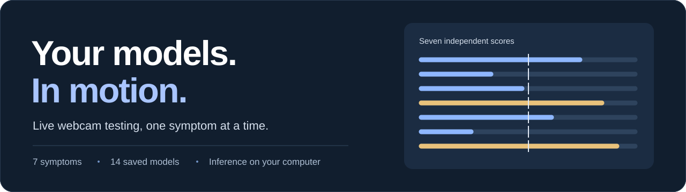
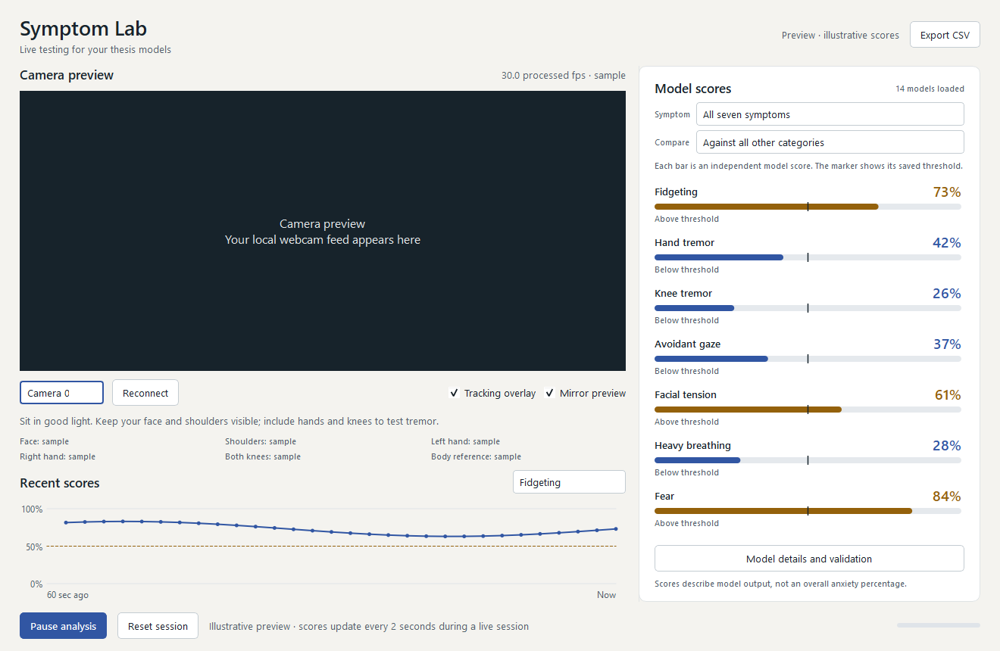

<p align="center">
  
</p>

<h1 align="center">Symptom Lab</h1>

<p align="center">
  A Windows webcam app for testing seven symptom detectors.<br>
  Pick a model, watch its score, and export the session.
</p>

<p align="center">
  
  
  
  
</p>

<p align="center">
  <a href="#setup-on-windows">Setup</a> &nbsp;·&nbsp;
  <a href="#a-look-inside">Preview</a> &nbsp;·&nbsp;
  <a href="#your-first-session">First session</a> &nbsp;·&nbsp;
  <a href="#understanding-the-scores">Scores</a> &nbsp;·&nbsp;
  <a href="#troubleshooting">Troubleshooting</a>
</p>

<p align="center">
  
</p>

## A look inside

<p align="center">
  
  <br>
  <sub>Actual application interface with illustrative scores. No participant footage is shown.</sub>
</p>

| While you test | When you review |
| :--- | :--- |
| Live camera preview with optional tracking overlays | Sixty seconds of score history |
| All seven symptoms or one focused model | Saved thresholds and held-out evaluation metrics |
| Two comparison modes for each symptom | CSV export with timestamps and tracking quality |
| Start, pause, resume, reset, and camera selection | Explicit missing-input and low-FPS messages |

**The fourteen trained classifiers are included.** You do not need the original dataset or a training run to use the webcam app. Face, body, and hand tracking bundles download automatically on first launch; later runs can work offline.

## Setup on Windows

### 1. Install the prerequisites

You need **64-bit Windows**, **64-bit Python 3.11**, and a webcam.

- Install Python through the [official Windows downloads page](https://www.python.org/downloads/windows/). Choose Python 3.11 and include the Python launcher when installing.
- Install [Git for Windows](https://git-scm.com/download/win) to use the clone command below. You can also use GitHub's **Code → Download ZIP** and extract the folder.

Open **PowerShell** and check Python:

```powershell
py -3.11 --version
```

You should see `Python 3.11.x`. The project uses pinned dependencies; use Python 3.11 for this setup.

### 2. Get the project

```powershell
git clone https://github.com/Vinzy0/thesis_models.git
cd thesis_models
```

If you downloaded a ZIP, open PowerShell inside the extracted project folder instead. You should see `webcam_app.py`, `requirements-webcam.txt`, and the `models` folder.

### 3. Create a separate Python environment

```powershell
py -3.11 -m venv .venv
```

The following commands call that environment's Python directly. You do not need to activate it or change your PowerShell execution policy.

### 4. Install the dependencies

```powershell
.\.venv\Scripts\python.exe -m pip install -r requirements-webcam.txt
```

Wait until installation finishes. This installs the desktop interface, tracking libraries, and the versions used to load the saved classifiers.

### 5. Open the app

```powershell
.\.venv\Scripts\python.exe webcam_app.py
```

A normal desktop window opens. On the first run, keep your internet connection available while the three tracking bundles download. The app verifies their checksums and caches them in `tracking_assets/`.

For later launches, **double-click `Start Webcam Tester.cmd`**. It uses the project's `.venv` when present and opens the window without a persistent console. The `.lnk` shortcut from the development computer is not required or distributed.

### 6. Allow camera access

If Windows blocks the preview, open **Settings → Privacy & security → Camera**, enable camera access for desktop apps, and click **Reconnect** in Symptom Lab. Close another program if it is already using the camera.

## Your first session

1. **Check the preview.** Use good light and keep your face and shoulders visible. For hand tremor, include at least one whole hand. For knee tremor, include both knees.
2. **Choose a camera.** Start with Camera 0. If it opens the wrong device, try another index and click Reconnect.
3. **Choose a symptom.** Use All seven symptoms for the overview, or select one detector.
4. **Choose the comparison.** Against control compares the symptom with control examples. Against all other categories compares it with control and the other six symptom categories.
5. **Press Start analysis.** The app settles for one second, then collects a four-second movement window. After the first result, it evaluates another window every two seconds.
6. **Inspect the result.** Click a symptom name to focus its history graph. Model details and validation shows that detector's threshold and dataset evaluation results.
7. **Save or reset.** Export CSV saves the session's scores and quality metadata. Pause keeps the preview running; resume collects a fresh window. Reset session clears unsaved scores and history.

> **Preview mirroring is visual only.** Inference uses the unmirrored camera frame. The app does not record or upload video.

## Understanding the scores

### Seven symptoms × two comparison modes

| Symptom | Against control | Against all other categories |
| :--- | :---: | :---: |
| Fidgeting | Included | Included |
| Hand tremor | Included | Included |
| Knee tremor | Included | Included |
| Avoidant gaze | Included | Included |
| Facial tension | Included | Included |
| Heavy breathing | Included | Included |
| Fear | Included | Included |

The bars show **independent classifier scores**. They do not add up to 100%, and a high score is not an overall anxiety percentage. The marker is the saved model's threshold, currently 50% for each bundled classifier.

| What you see | What it means |
| :--- | :--- |
| A percentage and a filled bar | A score from a complete movement window |
| Above / below threshold | How that score compares with the model's saved threshold |
| `--` and a positioning hint | Required tracking was insufficient; no score was produced |
| Low FPS warning beside a tremor score | The score is available, but slow sampling can affect it |
| Previous score / paused / stale | The visible number is not a fresh live result |

Hand tremor needs at least one tracked hand; knee tremor needs both knees confidently visible. Required tracking must cover at least half of the window. Below **20 processed fps**, tremor scores remain visible with a warning. Below **8 fps**, all scores are withheld. Waiting longer does not increase camera FPS.

The app requests 640 × 480 at 30 fps; the camera and processing load determine the actual rate. The feature pipeline resamples to a 30 Hz grid, which cannot restore movement the camera never captured.

### What gets exported

CSV records include the session and segment, UTC timestamp, window times, symptom, comparison mode, model score, threshold, tracking coverage, processed FPS, and warnings. Missing scores stay blank rather than becoming zero. Exports from different comparison modes retain their labels.

## Dataset evaluation

These are **window-level results from five-fold cross-validation with held-out participants**, using four-second windows and threshold 0.5. They describe the training dataset, not measured webcam accuracy.

| Symptom | Control F1 | Control AUC | All others F1 | All others AUC |
| :--- | ---: | ---: | ---: | ---: |
| Fidgeting | 0.850 | 0.905 | 0.456 | 0.832 |
| Hand tremor | 0.756 | 0.848 | 0.464 | 0.894 |
| Knee tremor | 0.757 | 0.829 | 0.378 | 0.744 |
| Avoidant gaze | 0.851 | 0.909 | 0.411 | 0.811 |
| Facial tension | 0.799 | 0.854 | 0.371 | 0.785 |
| Heavy breathing | 0.794 | 0.859 | 0.291 | 0.763 |
| Fear | 0.761 | 0.795 | 0.552 | 0.731 |

Aggregate evaluation metrics ship in [`model_metrics.json`](model_metrics.json). The app uses local training reports when available and falls back to this file on a fresh clone. Participant records and the source dataset are not included.

<details>
<summary><strong>Feature compatibility and research limits</strong></summary>

The live adapter reconstructs the coordinate conventions observed in the dataset: face coordinates are centered between the inner eyes and scaled by outer-eye distance; body and hand coordinates use the hip midpoint and shoulder line. Blendshape names, face-matrix layout, feature ordering, and window statistics match the saved feature schema.

The original raw-landmark exporter was not available. Exact exporter parity and live prediction accuracy remain unverified. The app labels its output as model scores; it is a research testing tool, not a validated clinical assessment.

Shared feature extraction has been checked against the cached training features, and all fourteen saved classifiers have been checked against direct predictions. Live capture, both comparison modes, CSV output, and worker shutdown have also been exercised. These checks establish software behavior, not clinical validity.

See the [training and feature reference](docs/TRAINING.md) for the complete feature pipeline, evaluation method, and data handling.

</details>

## Troubleshooting

| Problem | What to do |
| :--- | :--- |
| `py` is not recognized | Install Python 3.11 with the Python launcher, then reopen PowerShell. |
| `No module named …` | Run the dependency command from step 4 and launch with `.\.venv\Scripts\python.exe`. |
| Camera unavailable | Close other camera apps, check Windows camera permissions, try another index, then Reconnect. |
| Hand or knee score shows `--` | Read the positioning hint and check the tracking labels. Keep the required body areas visible throughout a full window. |
| Tremor shows a low-FPS warning | The score is still displayed. Improve lighting and reduce competing CPU load; watch processed FPS rather than the camera's advertised FPS. |
| Tracking bundle download fails | Check connectivity and reconnect. Partial downloads are discarded; bundles are checked again on startup. |
| Models cannot load | Confirm `models/` contains all fourteen `.joblib` files and use the pinned dependencies. Load model files only from a source you trust. |
| Changes do not appear after updating | Close and reopen the application; an existing process keeps its loaded code and models. |
| Startup fails without a console | Inspect `webcam_launcher.log`. For a console traceback, run `.\.venv\Scripts\python.exe webcam_app.py`. |

Keep **PySide6 6.10.1** from the requirements file. Do not replace the pinned versions during setup.

## Tests and development

Run the checks that need no research dataset or webcam:

```powershell
.\.venv\Scripts\python.exe -m unittest test_webcam_ui test_webcam.StartupTests -v
```

They cover UI state changes, visible low-FPS score warnings, download cancellation, and loading the bundled models and metrics without local training reports.

The full suite additionally needs the original `data.parquet` and `features.parquet` in the project root:

```powershell
.\.venv\Scripts\python.exe -m unittest test_webcam test_webcam_ui -v
```

For retraining, run `python run_all.py` from an environment with the training requirements and original data. Detailed commands are in [docs/TRAINING.md](docs/TRAINING.md).

### Project map

```text
thesis_models/
├── webcam_app.py              Native window, preview, controls, and history
├── webcam_core.py             Tracking adapter, buffering, inference, and CSV
├── common.py                  Shared training and live feature calculations
├── models/                    Fourteen trained LightGBM model bundles
├── model_metrics.json         Aggregate held-out evaluation results
├── launch_webcam.pyw          Windowed launcher with startup error reporting
├── Start Webcam Tester.cmd    Launcher that prefers the local .venv
├── requirements-webcam.txt    Pinned desktop dependencies
├── test_webcam*.py            Inference and native UI checks
├── docs/                      Preview assets and training reference
└── tracking_assets/           Downloaded on first launch; not in Git
```

To update an existing checkout, close the app first, then run:

```powershell
git pull
.\.venv\Scripts\python.exe -m pip install -r requirements-webcam.txt
```

### Built with

[PySide6 / Qt](https://doc.qt.io/qtforpython-6/) ·
[MediaPipe](https://developers.google.com/edge/mediapipe/solutions/vision/face_landmarker/python) ·
[OpenCV](https://docs.opencv.org/4.x/) ·
[LightGBM](https://lightgbm.readthedocs.io/)
